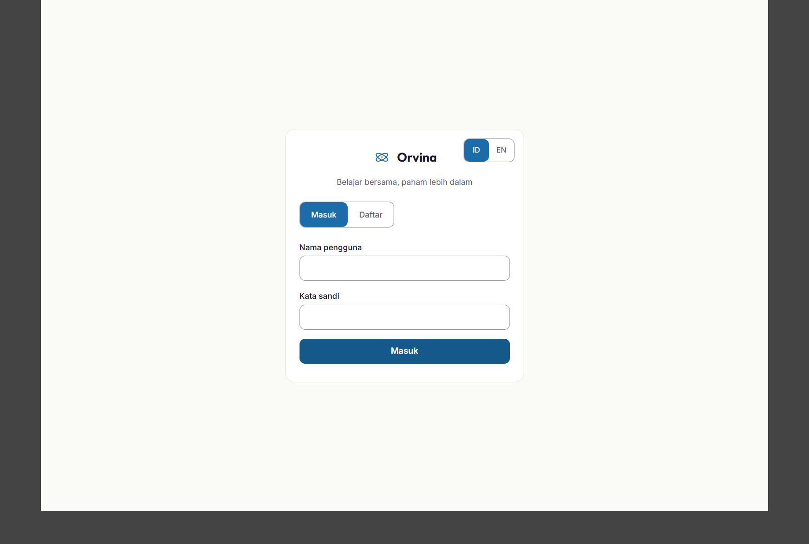
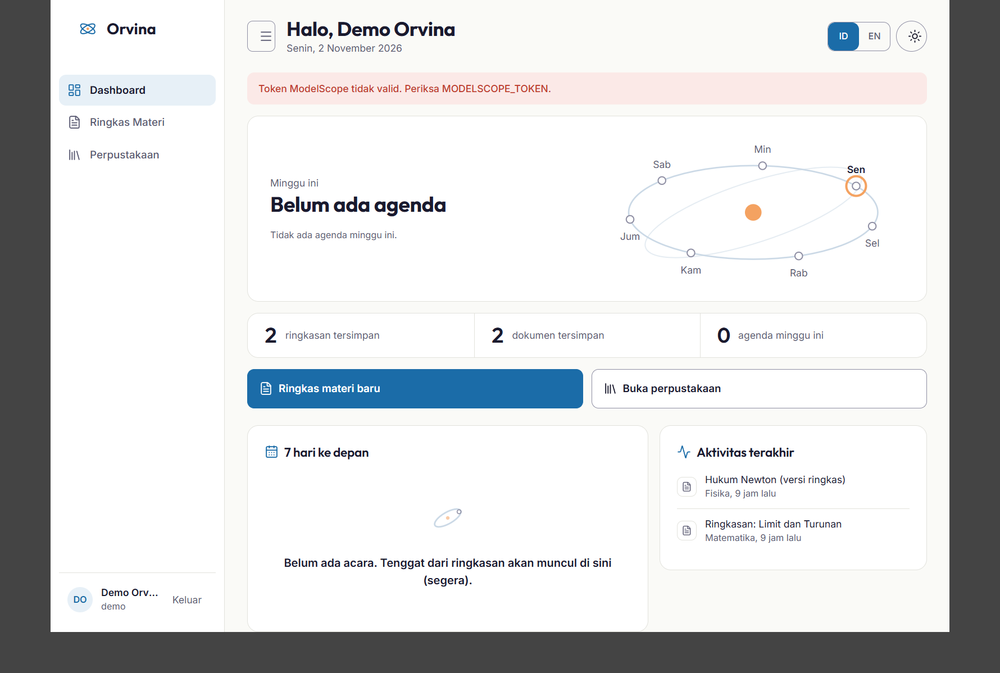
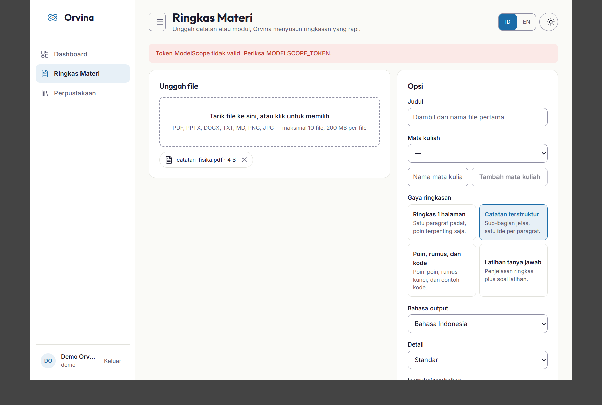
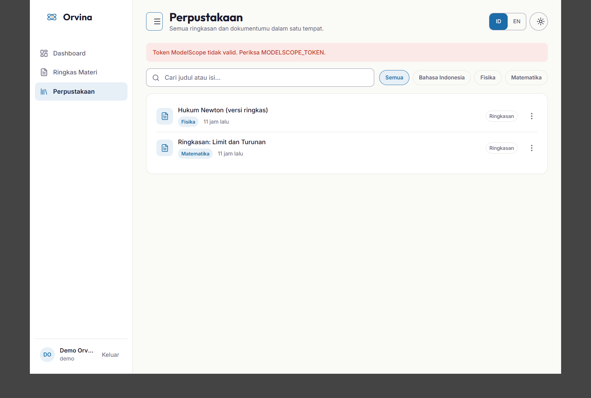
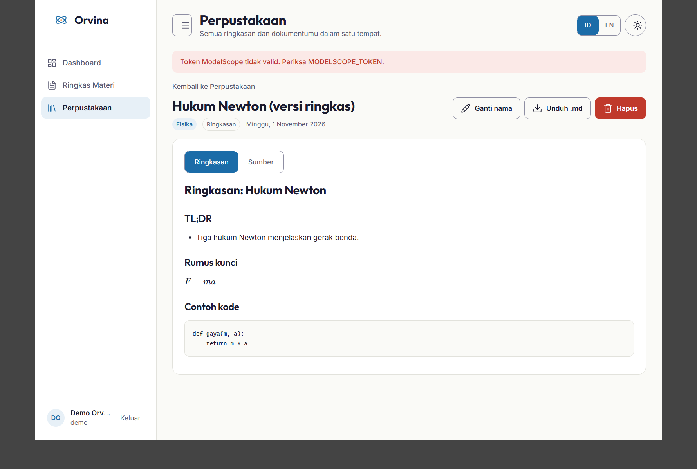
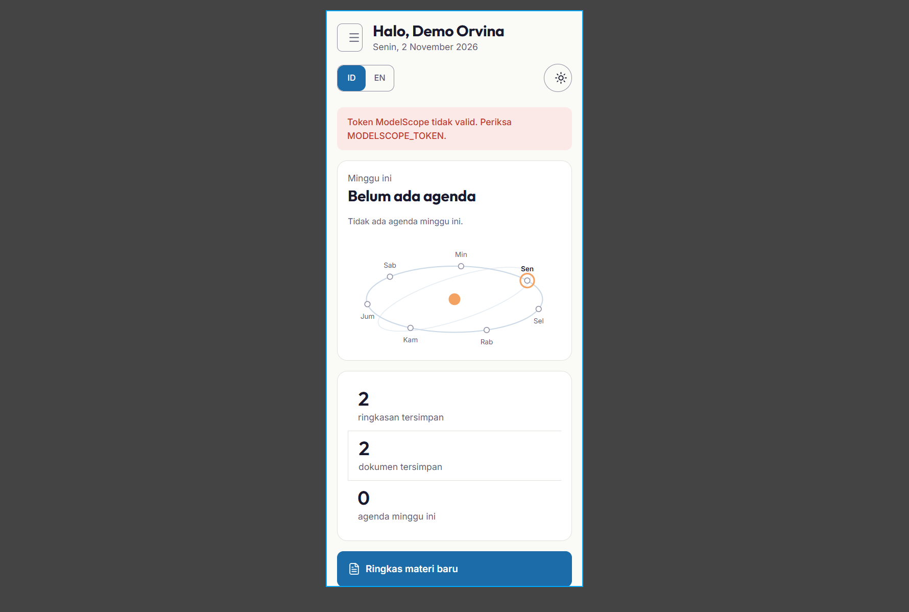

# Orvina

**Orvina** is a study companion for Indonesian students. Upload your class notes — PDF, PPTX, DOCX, TXT/MD or photos of pages — and Orvina turns them into a clean Markdown summary with LaTeX formulas and code blocks, saved in your personal library (Perpustakaan) with search and `.md` export. The dashboard greets you with real data: how many summaries you have, and the week ahead. One Docker image, one Python process, deployed on a free-CPU ModelScope Studio, using only the four competition models.

## Screenshots

| Login | Dashboard |
|---|---|
|  |  |

| Ringkas Materi | Perpustakaan |
|---|---|
|  |  |

| DocumentView (LaTeX) | Dashboard at 400 px |
|---|---|
|  |  |

The design target is `docs/design/dashboard-mockup.html`; a side-by-side capture is in
`docs/evidence/screenshots/mockup-vs-dashboard.png`.

## Architecture (SPEC §3.2, lean)

```
Browser (React SPA, usually inside the Studio iframe)
   │  HTTPS JSON · job progress by polling (2 s)
   ▼
server (Python, FastAPI, uvicorn --workers 1, 0.0.0.0:7860, the only port)
   ├─ serves web/dist (SPA fallback) and /api/*
   ├─ store/: SQLite (users, sessions, subjects, jobs, documents, event_suggestions, ai_calls)
   ├─ api/: routers per area (auth, me, subjects, summaries, jobs, documents, dashboard),
   │        Bearer sessions, rate limits, contract error JSON
   ├─ jobs/: thread pool (JOB_WORKERS = 2) running the summarize pipeline
   └─ ai/: LLM client (4 models, roles, retries, JSON repair, call tracing),
           extraction (PDF/PPTX/DOCX/TXT/images), summarize (6 stages)
Disk: DATA_DIR (/data if writable, else /tmp/orvina): orvina.db, uploads/
```

- **One process.** No supervisor, no internal port. Startup: migrate → seed if empty → listen.
- **AI isolation.** Only `server/ai/llm.py` imports `openai` and calls a model, via
  `https://api-inference.modelscope.ai/v1` (SPEC §2.1). The browser never calls an LLM.
- **SQLite.** One connection per thread; every write goes through `store.db.write()` under one lock.

## Setup

```bash
# Backend (Python 3.10+ in the image; any recent CPython locally)
uv venv .venv && uv pip install -p .venv -r server/requirements.txt
cp .env.example .env            # fill MODELSCOPE_TOKEN + APP_SECRET_KEY

# Frontend
cd web && npm install

# Run
make dev                        # FastAPI on 0.0.0.0:7860
make test                       # pytest server/tests
make lint                       # ruff + tsc + locale parity (id/en)
make build                      # web production bundle
make compliance                 # SPEC §12 scan
```

No Docker is required locally; the first real image build happens on the Studio.

## Environment variables (SPEC §4.1)

| Variable | Required | Meaning |
|---|---|---|
| `MODELSCOPE_TOKEN` | yes | ModelScope API token. In the Studio: a Studio Secret. Never in code, logs, docs or the bundle. |
| `APP_SECRET_KEY` | yes | Session/secret key. Studio Secret. |
| `DATA_DIR` | no | Data directory; falls back to `/data` if writable, else `/tmp/orvina`. An empty DB is migrated and seeded automatically. |
| `JOB_WORKERS` | no | Summarize thread pool size (default 2, free CPU). |
| `ENABLE_TRANSCRIPTION` | no | `false` by default and in the submission (scope cut; see Known limits). |
| `PROBE_MODEL` | no | Which allowed model the health probe pings (default the FAST role). |

## Model roles (SPEC §2.1)

| Role | Model | Used for |
|---|---|---|
| VISION | `Qwen/Qwen3.8-27B` | Reading image uploads (photos of pages) |
| FAST | `Qwen/Qwen3.8-27B` | Health probe (Step-3.5-Flash is unavailable on the API: "no provider supported") |
| REASON | `deepseek-ai/DeepSeek-V4-Pro-0813` | Map/reduce summarization, deadline extraction |
| CHECK | `zai-org/GLM-5.2` | Format check (LaTeX fences, code fences) with one repair retry |

## Competition compliance (SPEC §2 → where it is enforced)

| Rule | Enforced by |
|---|---|
| 1. Only the 4 allowed models, via the ModelScope gateway | Model IDs exist only in `server/ai/llm.py` (`ALLOWED_MODELS` + role map); `scripts/compliance.py` scans every file for any other model ID; no model ID anywhere in `web/` |
| 2. No proprietary AI, no Web Speech API | `llm.py` is the only HTTP AI client (ModelScope base URL); `scripts/compliance.py` scans all code for forbidden AI domains and `SpeechRecognition`/`webkitSpeechRecognition`; the web bundle has no speech UI |
| 3. faster-whisper at risk → ship with it off | `faster-whisper` removed from `server/requirements.txt`; `ENABLE_TRANSCRIPTION` defaults to `false` in `server/config.py`; `/api/health` reports `whisper: "disabled"` |
| 4. No training, no GPU, free CPU only | Single uvicorn worker (`Dockerfile` CMD), CPU-only dependencies, no training/fine-tuning code anywhere |
| 5. No secrets in code | Env vars only via `server/config.py`; `.env` is git- and docker-ignored; `scripts/compliance.py` scans for token-like strings in code, logs, tests, bundle and docs; the Studio uses Studio Secrets |
| 6. Agent-written code, ≤30 `MANUAL` lines | All code written by the agent (OpenCode, `Qwen/Qwen3.8-27B`); the agent never writes the `MANUAL` marker; `scripts/compliance.py` caps the count at 30 (current count: 16, all in rule descriptions, none in code) |
| 7. Studio stays Public, serves several judges | One process on port 7860; SQLite with per-thread connections + a single write lock; deploy steps in `docs/PROGRESS.md` ("Manual checks for the developer") set visibility Public |

## Libraries and licenses

- **Python:** fastapi, uvicorn, openai (OpenAI-compatible client for the ModelScope gateway), bcrypt, pypdf, python-pptx, python-docx, Pillow — BSD/MIT licensed.
- **Web:** react, react-dom, react-router-dom, react-markdown, remark-math, remark-gfm, rehype-katex, katex (MIT), lucide-react (ISC), @fontsource/outfit + @fontsource/inter (OFL), Vite + TypeScript (MIT).
- **Fonts:** Outfit (headings/numbers) and Inter (body), self-hosted via Fontsource — no web-font CDN, so the Studio iframe works offline of third parties.

License: Apache-2.0.

## Known limits (honest scope cut)

- **No audio or video.** F2 (Rekam & Transkrip) is cut; `faster-whisper` is not installed and `ENABLE_TRANSCRIPTION=false` in the submission.
- **No figures or charts** in summaries (the pipeline returns `figures: []`).
- **No Google Calendar** — the "7 hari ke depan" agenda is local (deadlines extracted from summaries), no OAuth.
- **No forum, points, leaderboard or notifications** — those endpoints return `501 not_implemented` per the contract and are hidden from the UI.
- **Polling only** — job progress is polled every 2 s (no SSE).
- **Languages:** `id` and `en` only (`zh` cut).
- **Data may reset.** The SQLite DB and uploads live on the Studio's disk (`DATA_DIR`); a Studio restart or redeploy can wipe them, and the app re-seeds the demo data on an empty DB.
- **Free CPU.** Summaries run in a 2-worker thread pool; expect roughly 1–3 minutes per document depending on size.
